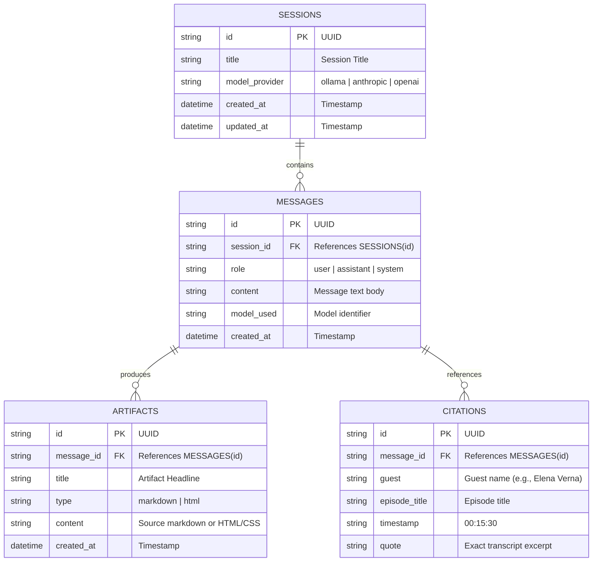
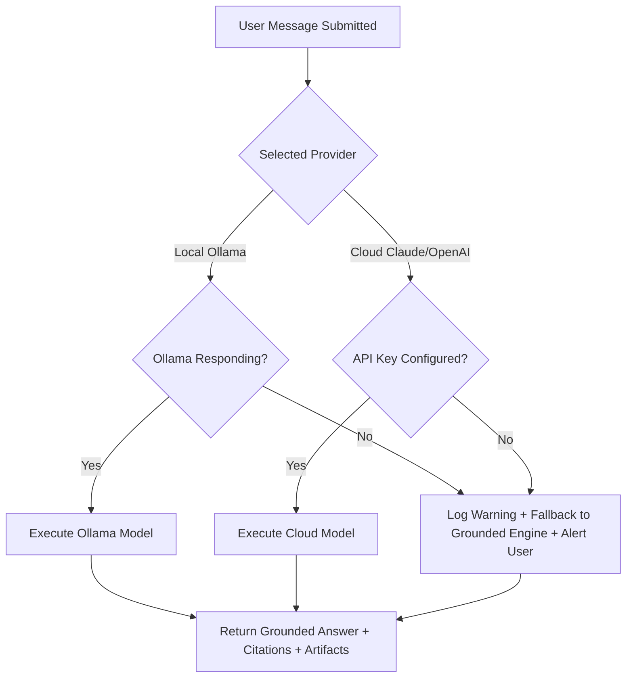

# System Architecture: The Lenny Growth Assistant
**Forward Deployed Engineering Technical Specification**
**Version:** 1.0.0

---

## 1. High-Level Architecture Overview

The Lenny Growth Assistant is designed as a resilient, decoupled client-server architecture with an agentic retrieval-augmented generation (RAG) core, multi-provider LLM abstraction, and an isolated artifact rendering pipeline.

```mermaid
graph TD
    Client[React + Vite Frontend\n(Chat UI + Claude Artifact Viewer)]
    API[FastAPI Backend Gateway\n(/api/chat, /api/sessions, /api/skills)]
    Agent[Agentic Orchestrator\n(Tool Router, Prompt Engine)]
    
    subgraph Data & Persistence
        DB[(PostgreSQL / SQLite\nSession & Message History)]
        Index[(BM25 & Vector Index\n50 Lenny Transcripts)]
    end
    
    subgraph Execution Models
        Ollama[Local Ollama LLM\n(llama3.2 / mistral)]
        Cloud[Cloud Provider\n(Anthropic Claude / OpenAI)]
        Fallback[Deterministic RAG Fallback\n(Zero-Dependency Engine)]
    end
    
    subgraph Skills & Security
        Ship30[Ship 30 for 30 Skill\n(~1250-Word Atomic Essay Engine)]
        Sandbox[Sandboxed Iframe Viewer\nsandbox='allow-scripts'\nNo allow-same-origin]
    end

    Client -->|REST / Streaming| API
    API --> Agent
    Agent -->|Read / Write| DB
    Agent -->|Hybrid Retrieval| Index
    Agent -->|Model Switcher| Ollama
    Agent -->|Model Switcher| Cloud
    Agent -->|Model Switcher| Fallback
    Agent -->|Skill Invocation| Ship30
    Ship30 -->|Structured Artifact| API
    API -->|Payload + Artifact| Client
    Client -->|Render Isolated| Sandbox
```

---

## 2. Component Boundaries & Responsibilities

| Component | Responsibility | Technologies |
| :--- | :--- | :--- |
| **Frontend (Web UI)** | Interactive chat, split-pane Claude Artifact Viewer, model toggle badge, session management, citation modals, responsive layout. | React 18, Vite, Lucide Icons, Vanilla CSS (rich dark/light aesthetics). |
| **API Gateway** | Request validation, session lifecycle, error handling, CORS, streaming protocol, health check endpoint. | FastAPI, Pydantic v2, Uvicorn. |
| **Agent Layer** | Intent recognition, RAG retrieval orchestration, tool invocation (Ship 30 writer, artifact generator), memory management. | Custom Agent Orchestrator following Claude Agent SDK / Pi Agent design patterns. |
| **Retrieval Engine** | Frontmatter extraction, speaker turn parsing, chunking (300-600 words), BM25 tokenization, dense semantic similarity, citation tracking. | Python, BM25 Okapi, TF-IDF vectorizer, regex speaker parser. |
| **LLM Provider Layer** | Unified interface for local and cloud models with automated health verification and seamless fallback. | Ollama HTTP API, Anthropic SDK, OpenAI SDK, Grounded Fallback Engine. |
| **Persistence Layer** | Stores chat sessions, message histories, citations, and generated artifacts with ACID guarantees. | SQLAlchemy 2.0, PostgreSQL (Supabase/Railway/Docker) with SQLite auto-fallback. |
| **Security Sandbox** | Strict client-side isolation for executing generated HTML/CSS artifacts. | W3C Sandboxed Iframe (`allow-scripts`, no `allow-same-origin`), CSP headers. |

---

## 3. Database Schema

The database model is defined via SQLAlchemy 2.0 with UUID primary keys and ISO timestamp auditing.



---

## 4. Ingestion & Retrieval Pipeline

1. **Ingestion & Parsing (`ingestion_service.py`):**
   * Reads 50 markdown transcripts from `backend/data/transcripts/`.
   * Extracts YAML frontmatter (`title`, `date`, `guest`, `channel`, `description`).
   * Parses dialogues using speaker tag regex `\*\*([^*]+)\*\*\s*\(([^)]+)\):`.
   * Segments into sliding window chunks of 350-500 words with 50-word overlaps to preserve conversational context.
   * Generates a cached JSON index file (`index_cache.json`) for sub-second startup times.

2. **Hybrid Retrieval (`retrieval_service.py`):**
   * Computes BM25 Okapi lexical scores for keyword precision (e.g. "Elena Verna", "recapture product market fit", "barrels vs ammo").
   * Computes TF-IDF / dense cosine vector similarity across chunk tokens.
   * Reranks and selects Top-K chunks ($K=4$), merging adjacent chunks from the same episode to prevent fragmented context.
   * Extracts structured citations with guest name, title, timestamp, and verifiable quote snippet.

---

## 5. Flexible LLM Abstraction & Fallback Topology

The system implements a unified `LLMClient` interface:
* `LocalOllamaClient`: Dispatches to `http://localhost:11434/api/generate` or `http://localhost:11434/api/chat`.
* `AnthropicClient`: Dispatches to `https://api.anthropic.com/v1/messages` (Claude 3.5 Sonnet / Haiku).
* `OpenAIClient`: Dispatches to `https://api.openai.com/v1/chat/completions` (GPT-4o / GPT-4o-mini).
* `GroundedFallbackClient`: When Ollama is offline and cloud API keys are absent, dynamically extracts the synthesized answer from the retrieved transcript chunks and returns full citations and artifacts.

### Fallback Decision Matrix:


---

## 6. Ship 30 for 30 Dedicated Content Skill

The **Ship 30 for 30 Skill** is an encoded algorithmic prompt system grounded in Nicolas Cole & Dickie Bush’s digital writing architecture:
* **Target Length:** Approximately 1,250 words (Pillar Atomic Essay).
* **Narrative Arc:**
  1. *The Hook:* Intriguing opening with high stakes and contrast.
  2. *The Villain / Conventional Wisdom:* What most PMs/founders get wrong.
  3. *The Shift / Core Principle:* The counter-intuitive operator insight from Lenny's guest.
  4. *The 3-5 Actionable Pillars:* Tactical breakdowns with bullet points and single-sentence paragraphs.
  5. *Selective Bold Emphasis:* Bold key phrases for visual skimmability.
  6. *The Takeaway:* Immediate tactical challenge or 24-hour implementation rubric.
* **Grounding:** Quotes and frameworks are directly attributed to transcript guests.

---

## 7. Artifact Sandboxing & Security Architecture

### Threat Model:
When an LLM generates HTML/CSS, untrusted code could theoretically:
1. Steal localStorage/session tokens via `window.localStorage` or document cookies.
2. Make unauthorized network requests (`fetch` / `XMLHttpRequest`) originating from the host domain.
3. Redirect the user's browser window (`top.location.href`).
4. Execute malicious browser exploits.

### Defense-in-Depth Implementation:
1. **Server-Side Sanitization (`security_service.py`):**
   * Inspects HTML for dangerous protocols (`javascript:`, `data:`, `vbscript:`).
   * Strips parent window manipulation (`parent.location`, `top.location`, `window.parent.postMessage`).
2. **Client-Side Iframe Isolation (`ArtifactViewer.jsx`):**
   * Uses an `<iframe>` rendered via `srcDoc`.
   * **Attributes:** `sandbox="allow-scripts"` (strictly NO `allow-same-origin`).
   * **Why this works:** Without `allow-same-origin`, the browser treats the iframe as a unique, opaque null-origin. It CANNOT access the parent host's cookies, localStorage, DOM, or API headers.
   * Content Security Policy (CSP) meta tag injected into the document head restricting connections to `connect-src 'none'`.

---

## 8. Deployment Topology

The application supports three zero-friction deployment targets:
1. **Local Developer Run:**
   * Backend: `python run.py` (FastAPI on `http://localhost:8000`)
   * Frontend: `npm run dev` (Vite on `http://localhost:5173`)
   * Database: Persistent SQLite fallback with zero setup.
2. **Docker Compose:**
   * Single command: `docker compose up --build`
   * Services: `frontend`, `backend`, `postgres`, and optional `ollama`.
3. **Cloud Production (Supabase + Railway / Render):**
   * Database: Hosted Supabase PostgreSQL.
   * Backend: Railway container with `DATABASE_URL` and `ANTHROPIC_API_KEY`.
   * Frontend: Vercel or Netlify static build.
