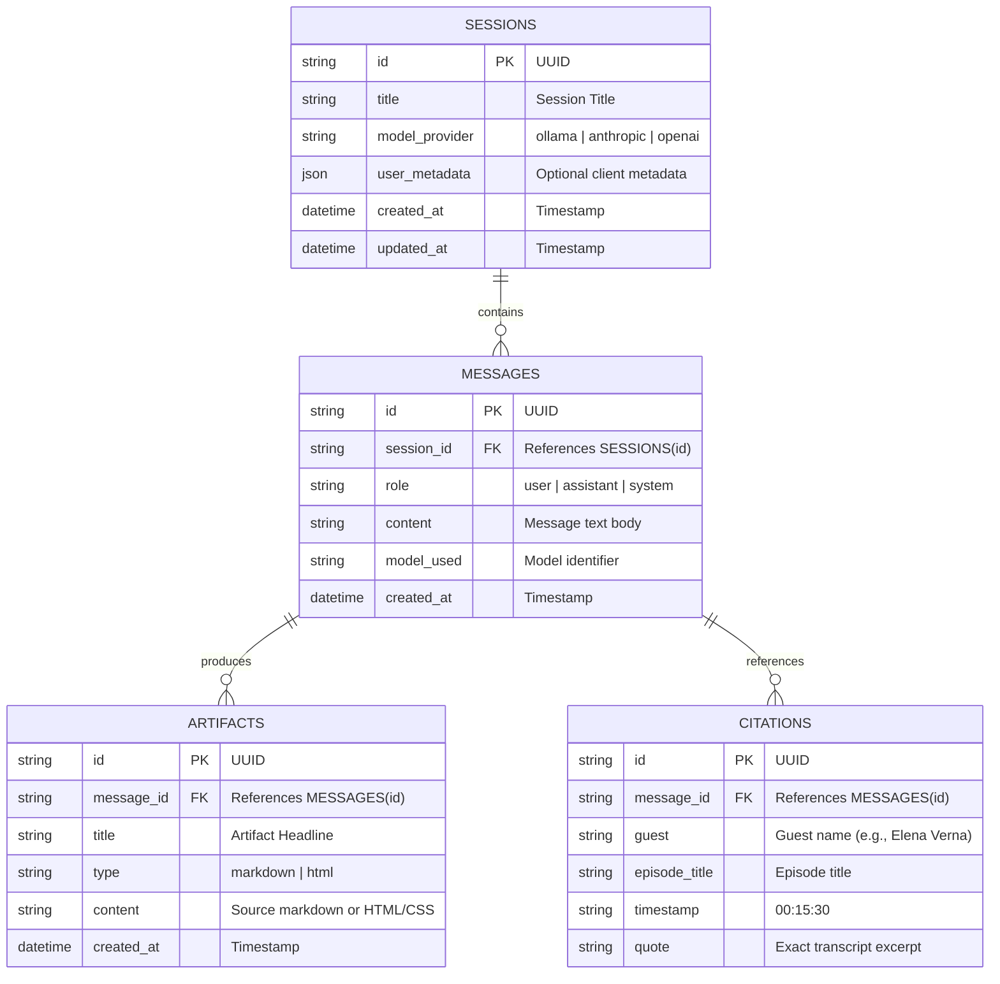
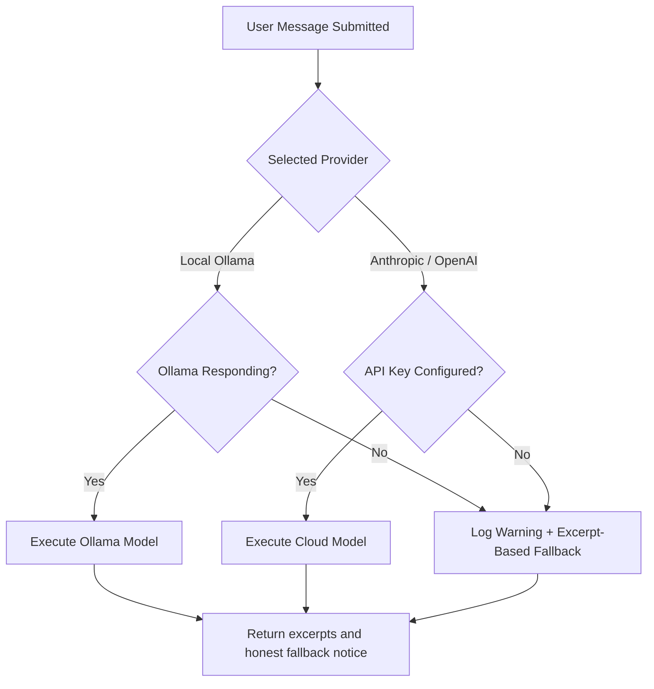

# System Architecture: The Lenny Growth Assistant
**Forward Deployed Engineering Technical Specification**
**Version:** 1.0.0

---

## 1. High-Level Architecture Overview

The Lenny Growth Assistant is a local-first prototype with a FastAPI API, React client, lexical RAG, configurable model providers, and isolated artifact rendering. This document describes the current implementation; production deployment and semantic retrieval are not included.

```mermaid
graph TD
    Client[React + Vite Frontend\n(Chat UI + Claude Artifact Viewer)]
    API[FastAPI Backend Gateway\n(/api/chat, /api/sessions, /api/models, /api/health)]
    Agent[Application Intent Router\n(Retrieval and Provider Selection)]
    
    subgraph Data & Persistence
        DB[(SQLite local / PostgreSQL Compose\nSessions, Metadata, Messages, Citations, Artifacts)]
        Index[(BM25 Index\n50 Lenny Transcript Files)]
    end
    
    subgraph Execution Models
        Ollama[Local Ollama LLM\n(llama3.2 / mistral)]
        Cloud[Anthropic Agent SDK / OpenAI API]
        Fallback[Excerpt-Based Fallback\n(No Generated Analysis)]
    end
    
    subgraph Skills & Security
        Ship30[Ship 30 for 30 Skill\n(~1250-Word Atomic Essay Engine)]
        Sandbox[Sandboxed Iframe Viewer\nsandbox='allow-scripts'\nNo allow-same-origin]
    end

    Client -->|REST| API
    API --> Agent
    Agent -->|Read / Write| DB
    Agent -->|BM25 Retrieval + Recent User Turns| Index
    Agent -->|Model Switcher| Ollama
    Agent -->|Model Switcher| Cloud
    Agent -->|Model Switcher| Fallback
    Agent -->|Skill Invocation| Ship30
    Ship30 -->|Structured Artifact| API
    API -->|Payload + Artifact| Client
    Client -->|Render Isolated| Sandbox
```

---

## 2. Component Boundaries & Responsibilities

| Component | Responsibility | Technologies |
| :--- | :--- | :--- |
| **Frontend (Web UI)** | Interactive chat, split-pane Claude Artifact Viewer, model toggle badge, session management, citation modals, responsive layout. | React 18, Vite, Lucide Icons, Vanilla CSS (rich dark/light aesthetics). |
| **API Gateway** | Validates requests; serves chat, session CRUD, provider status, transcript catalog, and database health. Errors are logged and returned with a stable code. | FastAPI, Pydantic v2, Uvicorn. |
| **Application Router** | Detects essay/document/HTML requests, retrieves excerpts, passes the recent conversation, and persists the result. | Python service layer; Anthropic requests use Claude Agent SDK with built-in tools disabled. |
| **Retrieval Engine** | Parses transcript frontmatter and speaker turns, chunks around 400 words with a one-turn overlap, ranks with BM25 and guest-name boost. | Python, custom BM25 implementation. No vector or embedding index. |
| **LLM Provider Layer** | Uses Ollama HTTP, Anthropic Agent SDK, or OpenAI API; provider failures route to an excerpt-based fallback. | Ollama, `claude-agent-sdk`, OpenAI SDK. |
| **Persistence Layer** | Stores sessions, optional user metadata, messages, citations, and artifacts. SQLite is the direct-run default; Compose configures PostgreSQL. | SQLAlchemy; SQLite and PostgreSQL. |
| **Artifact Rendering** | Markdown is parsed then sanitized with DOMPurify. HTML is displayed in an iframe with scripts enabled but without same-origin privileges. | `marked`, DOMPurify, sandboxed iframe, restrictive CSP. |

---

## 3. Database Schema

The database model is defined via SQLAlchemy 2.0 with UUID primary keys and ISO timestamp auditing.



---

## 4. Ingestion & Retrieval Pipeline

1. **Ingestion & Parsing (`ingestion_service.py`):**
   * Reads 50 markdown transcripts from `backend/data/transcripts/`.
   * Extracts YAML frontmatter (`title`, `date`, `guest`, `channel`, `description`).
    * Parses dialogues using speaker tag regex `\*\*([^*]+)\*\*\s*\(([^)]+)\):`.
    * Combines timestamped speaker turns into chunks of about 400 words, retaining the final speaker turn as overlap.
    * Caches chunks in `index_cache.json`; the cache is loaded on later starts and is not freshness-checked against transcript edits.

2. **Lexical Retrieval (`retrieval_service.py`):**
    * Ranks transcript chunks with BM25 and a guest-name match boost.
    * Includes recent user questions in the search query for short follow-ups; it does not compute semantic embeddings or dense vector similarity.
    * Selects up to four qualifying chunks and emits guest, episode, chunk-start timestamp, and a short excerpt as citation data.

---

## 5. Flexible LLM Abstraction & Fallback Topology

Provider routing is implemented in `llm_service.py`:
* Ollama uses the local `/api/generate` endpoint.
* Anthropic uses the Claude Agent SDK `query()` API with built-in tools disabled, settings loading disabled, one turn, and a request timeout.
* OpenAI uses the Chat Completions API.
* Provider failures or missing credentials return a deterministic response containing retrieved excerpts. Offline essay/document output is a source brief, not a generated long-form essay.

### Fallback Decision Matrix:


---

## 6. Ship 30 for 30 Dedicated Content Skill

The **Ship 30 for 30 Skill** is an encoded algorithmic prompt system grounded in Nicolas Cole & Dickie Bush’s digital writing architecture:
* **Target Length:** Approximately 1,250 words (Pillar Atomic Essay).
* **Narrative Arc:**
  1. *The Hook:* Intriguing opening with high stakes and contrast.
  2. *The Villain / Conventional Wisdom:* What most PMs/founders get wrong.
  3. *The Shift / Core Principle:* The counter-intuitive operator insight from Lenny's guest.
  4. *The 3-5 Actionable Pillars:* Tactical breakdowns with bullet points and single-sentence paragraphs.
  5. *Selective Bold Emphasis:* Bold key phrases for visual skimmability.
  6. *The Takeaway:* Immediate tactical challenge or 24-hour implementation rubric.
* **Grounding:** Quotes and frameworks are directly attributed to transcript guests.

---

## 7. Artifact Sandboxing & Security Architecture

### Threat Model:
When an LLM generates HTML/CSS, untrusted code could theoretically:
1. Steal localStorage/session tokens via `window.localStorage` or document cookies.
2. Make unauthorized network requests (`fetch` / `XMLHttpRequest`) originating from the host domain.
3. Redirect the user's browser window (`top.location.href`).
4. Execute malicious browser exploits.

### Current Controls and Limits:
1. **Server-Side Inspection (`security_service.py`):**
    * Applies pattern-based checks and adds a CSP meta policy. The checks are not a general-purpose HTML sanitizer.
2. **Client-Side HTML Isolation (`ArtifactViewer.jsx`):**
   * Uses an `<iframe>` rendered via `srcDoc`.
   * **Attributes:** `sandbox="allow-scripts"` (strictly NO `allow-same-origin`).
   * **Why this works:** Without `allow-same-origin`, the browser treats the iframe as a unique, opaque null-origin. It CANNOT access the parent host's cookies, localStorage, DOM, or API headers.
    * CSP blocks network connections, remote images/fonts, forms, frames, and plugins. Inline script remains available for interactive prototypes, confined to the sandbox.
3. **Markdown Rendering:** `marked` output is sanitized with DOMPurify before insertion into the chat or artifact pane.

---

## 8. Deployment Topology

The application supports three zero-friction deployment targets:
1. **Local Developer Run:**
   * Backend: `python run.py` (FastAPI on `http://localhost:8000`)
   * Frontend: `npm run dev` (Vite on `http://localhost:5173`)
   * Database: Persistent SQLite fallback with zero setup.
2. **Docker Compose:**
   * Single command: `docker compose up --build`
   * Services: `frontend`, `backend`, `postgres`, and optional `ollama`.
3. **Hosted Deployment:** Supabase/Railway/Vercel are possible targets, but no hosted deployment configuration or production validation is included in this repository.
